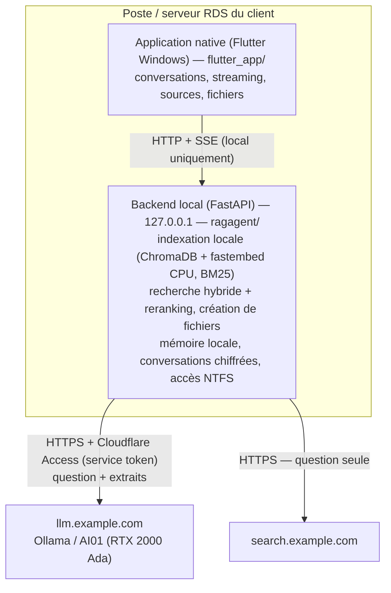

<div align="center">
  

  # Jade

  **Assistant documentaire d'entreprise, « local d'abord »**

  
  
  
  
</div>

Jade indexe les documents d'une entreprise sur le poste ou le serveur du client,
répond aux questions en citant ses sources, et **n'envoie jamais les documents à
l'extérieur** : seuls la question et de courts extraits de texte transitent, en
HTTPS chiffré, vers le serveur d'inférence Jade (Ollama, via Cloudflare Tunnel
+ Access).

> **Aucun secret dans ce dépôt.** Les identifiants (jetons Cloudflare, mots de
> passe) sont saisis par le technicien pendant l'installation, ou renseignés dans
> un `.env` local en développement (voir `.env.example`).

---

## Comment ça fonctionne



- **Interface et backend sont séparés.** L'application **Flutter native**
  (`flutter_app/`) ne fait que l'interface ; toute l'intelligence (indexation,
  recherche, sécurité, génération) vit dans le **backend local** (`ragagent/`),
  une API qui n'écoute que sur `127.0.0.1`.
- Au premier lancement, l'application démarre le backend s'il est installé à côté
  d'elle, puis s'y connecte.
- **Rien ne sort du poste** sauf la question et de courts extraits — journalisés
  avant envoi dans `logs/outbound.jsonl`. Pas de cloud tiers, pas d'API IA externe.

## Fonctionnalités

- **Intelligence** : une **pré-analyse** (petit modèle) décide à chaque question
  entre *documents internes / recherche web / réponse directe*, et détecte un
  éventuel fichier à créer. Trois niveaux de modèles (petit / standard /
  performant) selon la complexité.
- **Recherche hybride + reranking** : vectoriel (`multilingual-e5-large`,
  CPU/ONNX) + BM25, fusion RRF, puis cross-encoder multilingue (`jina-reranker-v2`).
- **Formats indexés** : `.docx .xlsx .xls .pdf .txt .md .csv .html .odt .eml .msg`
  (`.pst` best-effort). OCR local (RapidOCR) pour images et PDF scannés —
  **optionnel** (`pip install .[ocr]`), non inclus dans l'installateur léger.
- **Création de fichiers** à la demande : Word, Excel, PDF, PowerPoint, CSV,
  Texte, Markdown, HTML.
- **Recherche web** encadrée (SearXNG interne, repli DuckDuckGo), sur intention
  explicite ou quand les documents ne répondent pas.
- **Suggestions d'accueil personnalisées** (d'après l'historique) et **questions
  de suivi** après chaque réponse.
- **Conversations** : multi-tours, dossiers, épingles, titres générés par IA,
  recherche dans le contenu, export Word. **Mémoire** inter-conversations locale.
- **Réglages** : dossiers à indexer, réindexation, suppression de tout
  l'historique. **Sans dossier indexé**, Jade répond comme un assistant général
  (web + connaissances).
- **Retour utilisateur** : bouton « Donner mon avis » — ouvre le client e-mail
  par défaut du poste (Windows/macOS/Linux) pré-rempli vers `feedback@example.com`, et
  prépare un **zip de diagnostic** (journaux, version — sans secret) à joindre.
- **Sécurité** : chiffrement au repos (conversations DPAPI, index EFS),
  filtrage des droits NTFS par utilisateur, **backend isolé par session RDS**
  (port dédié), secrets du `.env` **scellés (DPAPI machine) + ACL restreinte**,
  garde anti-DNS-rebinding sur l'API locale.
- **Confort** : mode incognito, thème clair / sombre / **auto**, multi-utilisateur
  (conversations isolées par session), interface française.
- **Mises à jour** : détection automatique de la dernière version publiée sur
  Gitea. Sur poste client, un **bouton** propose de télécharger et installer ;
  sur serveur RDS, une **tâche planifiée nocturne** l'applique hors session.

## Stack technique

| Couche | Technologie | Version |
|--------|-------------|---------|
| Application | Jade | 1.8.0 |
| Interface | Flutter (Dart SDK) / `http` / `flutter_markdown` | SDK `^3.12.2` / 1.2 / 0.7 |
| Backend | Python | >= 3.12 |
| API locale | FastAPI / Uvicorn | 0.139.0 / 0.49.0 |
| Vector store | ChromaDB (PersistentClient, embarqué) | 1.5.9 |
| Embeddings | fastembed (ONNX CPU) — `multilingual-e5-large` | 0.8.0 |
| Recherche mots-clés | rank-bm25 | >= 0.2 |
| Reranking | fastembed cross-encoder — `jina-reranker-v2` | 0.8.0 |
| Parsing | python-docx / openpyxl / pypdf / extract-msg / odfpy | 1.2 / 3.1.5 / 6.14.2 / >= 0.48 / >= 1.4 |
| Création de fichiers | python-docx / python-pptx / openpyxl / reportlab | 1.2 / >= 1.0 / 3.1.5 / >= 4.0 |
| OCR (optionnel) | rapidocr-onnxruntime | >= 1.3 |
| Client HTTPS sortant | httpx | 0.28.1 |
| Licences (JWT Ed25519) | pyjwt[crypto] | >= 2.9 |
| LLM central | Ollama (`qwen3.5`, 3 niveaux) | — |
| Packaging | PyInstaller + Inno Setup 6 | >= 6.0 / 6 |

## Prérequis

- **Windows 10/11** (x64) — plateforme livrée. Le code est **prêt pour macOS et
  Linux** (backend portable, runners Flutter générés) ; restent les builds et
  installateurs natifs à produire sur ces OS.
- Accès réseau sortant HTTPS vers `llm.example.com` et `search.example.com`.
- Pour le **développement** : Python **3.12+** et le **SDK Flutter** (canal stable,
  desktop Windows activé).

## Installation (poste client)

Utiliser l'installateur `Jade-Setup-1.8.0.exe` (voir *Build* plus bas).
**Aucun secret n'est embarqué dans l'installateur** : pendant l'installation,
l'assistant demande les **identifiants d'accès Jade** (adresse du serveur LLM,
jetons Cloudflare Access — un seul couple pour tous les services — éventuel
SearXNG). Ils sont écrits dans un `.env` **local au poste**, dont les **secrets
sont scellés (DPAPI machine)** et l'**ACL restreinte aux administrateurs** —
rien ne sort, rien n'est distribué avec l'exe.

- Installe l'application dans `C:\Program Files\Jade`.
- Pose l'index partagé, les journaux et le cache de modèles dans
  `C:\ProgramData\Jade` (inscriptible par tous les utilisateurs du serveur).
- Les conversations de chaque utilisateur restent dans `%LOCALAPPDATA%\Jade`.
- Les **modèles de recherche locaux** (embeddings + reranker, ~3,2 Go) sont
  **téléchargés automatiquement au premier lancement** dans
  `C:\ProgramData\Jade\models` (une seule fois), avec **barre de progression**.
  Source par défaut : une **archive `.tar` hébergée sur Cloudflare R2**
  (`MODELS_URL`) — fiable, avec **reprise** sur coupure ; repli automatique sur
  HuggingFace. L'installateur reste léger (~90 Mo). *Note : l'OCR des documents
  scannés/images n'est pas inclus dans cette version légère.*

  > **Héberger l'archive des modèles.** Créer l'archive avec
  > `tar -chf jade-models.tar --exclude=blobs --exclude=.locks -C <cache> .`
  > (où `<cache>` = un `C:\ProgramData\Jade\models` déjà peuplé), puis la
  > déposer sur **Cloudflare R2** (stockage objet, pas de serveur d'origine à
  > proxifier) et rendre le bucket public. **Ne pas** servir ce fichier depuis un
  > site derrière le proxy Cloudflare classique (nuage orange) : le proxy HTTP a
  > un timeout d'environ 120 s et ne relaie pas toujours les requêtes Range —
  > constaté en pratique (téléchargement systématiquement tronqué vers ~2 Go).
  > R2 n'a pas cette limite et supporte nativement les requêtes Range (repris
  > sur coupure). Upload volumineux (>300 Mo) : utiliser l'API S3 de R2
  > (`rclone`/`aws s3`), pas le tableau de bord.

Au premier démarrage, l'index est vide : ouvrir les **Réglages** (roue crantée)
et ajouter les dossiers / lecteurs réseau à indexer.

## Configuration

La configuration vit dans un fichier **`.env`** :
- **En développement** : copier `.env.example` en `.env` et renseigner les
  identifiants (`copy .env.example .env`).
- **En installé** : le fichier est **généré automatiquement par l'assistant
  d'installation** (à côté de l'exécutable), à partir des identifiants saisis.

**Aucun secret n'est versionné dans le dépôt.** Défauts définis dans
`ragagent/config.py` (`load_settings`). Un secret vide non renseigné désactive
proprement la fonctionnalité associée.

| Clé | Type | Défaut | Rôle |
|-----|------|--------|------|
| `DOCS_DIR` `DATA_DIR` `LOG_DIR` `MODEL_CACHE_DIR` | chemin | `.\testdata` `.\data` `.\logs` `.\models` (dev) | dossiers locaux ; en installé, sous `%PROGRAMDATA%\Jade` |
| `EMBED_MODEL` | str | `intfloat/multilingual-e5-large` | modèle d'embeddings (changer force une réindexation) |
| `CHUNK_TOKENS` / `CHUNK_OVERLAP` | int | `400` / `60` | découpage des chunks |
| `TOP_K` / `MIN_SCORE` | int / float | `10` / `0.35` | nombre de candidats / seuil de pertinence |
| `OLLAMA_URL` | url | `https://llm.example.com` | LLM central (via Cloudflare Access) |
| `OLLAMA_MODEL` | str | `qwen3.5:4b` | modèle standard |
| `ROUTER_MODEL` | str | `` (→ `OLLAMA_MODEL`) | petit modèle de pré-analyse |
| `STRONG_MODEL` | str | `` (→ `OLLAMA_MODEL`) | modèle performant (questions complexes) |
| `VISION_MODEL` | str | `qwen3.5:9b` | modèle multimodal (images) |
| `NUM_CTX` / `REQUEST_TIMEOUT` | int / float(s) | `8192` / `120` | contexte LLM / timeout requête |
| `CF_ACCESS_CLIENT_ID` / `CF_ACCESS_CLIENT_SECRET` | secret | `` | service token Cloudflare Access du LLM |
| `UI_HOST` / `UI_PORT` | str / int\|`auto` | `127.0.0.1` / `8765` | API locale (`auto` = port par session RDS) |
| `CLIENT_NAME` / `KEEP_ALIVE` | str | `Jade` / `30m` | libellé client / maintien du modèle en mémoire |
| `REINDEX_MINUTES` | int | `30` | réindexation automatique périodique |
| `WEB_FALLBACK` / `WEB_RESULTS` | bool / int | `1` / `3` | recherche web de repli / nombre de résultats |
| `SEARXNG_URL` + `SEARXNG_CF_ACCESS_CLIENT_ID`/`_SECRET` | url + secret | `` | recherche web interne (SearXNG) |
| `FEEDBACK_EMAIL` | str | `feedback@example.com` | destinataire du retour utilisateur (client e-mail par défaut) |
| `OCR_ENABLED` / `OCR_INDEX` | bool | `1` / `1` | OCR local (nécessite l'extra `[ocr]`) |
| `HYBRID_ENABLED` / `RERANK_ENABLED` | bool | `1` / `1` | recherche hybride BM25 / reranking cross-encoder |
| `RERANK_MODEL` | str | `jinaai/jina-reranker-v2-base-multilingual` | modèle de reranking |
| `CPU_THREADS` | int | `2` | threads ONNX (borné sur RDS partagé) |
| `NTFS_FILTER` | bool | `1` | filtrage des droits NTFS par utilisateur |
| `UPDATE_ENABLED` / `UPDATE_MODE` | bool / str | `1` / `manual` | `manual` (poste : bouton) ou `scheduled` (RDS : tâche nocturne) |
| `GITEA_API_URL` / `GITEA_REPO` / `GITEA_TOKEN` | url / str / secret | `https://git.example.com` / `example/jade` / `` | source des mises à jour (releases Gitea) |
| `SETUP_PASSWORD` | secret | `` | mot de passe de l'installateur (auto-update silencieux) |
| `MODELS_URL` / `MODELS_SHA256` | url / str | `https://models.example.com/jade-models.tar` / `` | archive des modèles + empreinte vérifiée |
| `LICENSE_ENABLED` | bool | `0` | active le système de licences (voir *Licences*) |
| `LICENSE_URL` / `LICENSE_KEY` | url / secret | `` | serveur de licences / clé opaque du client |
| `LICENSE_PUBLIC_KEY` | str | clé DEV embarquée | clé publique Ed25519 (vérif JWT hors ligne) |
| `LICENSE_CF_ACCESS_CLIENT_ID`/`_SECRET` | secret | `` | service token Cloudflare dédié au serveur de licences |
| `GRACE_DAYS` | int | `7` | tolérance hors ligne après expiration du bail |

## Développement

```bash
# 1) Backend local (API)
python -m venv .venv
.venv\Scripts\activate
pip install -e .
copy .env.example .env   # puis renseigner les identifiants
jade check       # vérifie embeddings, store local, accès LLM
jade serve       # backend sur http://127.0.0.1:8765

# 2) Application native (dans un autre terminal)
cd flutter_app
flutter run -d windows
```

## Build

```bash
# 1) Application native  ->  flutter_app/build/windows/x64/runner/Release/
cd flutter_app
flutter build windows --release

# 2) Backend gelé (sidecar)  ->  dist/Jade/
python -m PyInstaller jade.spec --noconfirm

# 3) Installateur  ->  dist/installer/
"%LOCALAPPDATA%\Programs\Inno Setup 6\ISCC.exe" installer\jade.iss
# Installateur PROTÉGÉ (contenu chiffré, mot de passe requis à l'installation) :
"%LOCALAPPDATA%\Programs\Inno Setup 6\ISCC.exe" /DSetupPassword=CE_MDP installer\jade.iss
```

> Le mot de passe d'installation n'est **jamais** dans le dépôt : il est passé au
> build via `/DSetupPassword`. Il est aussi écrit dans le `.env` local
> (`SETUP_PASSWORD`) pour que l'auto-update reste silencieux.

- `jade.spec` : recette PyInstaller du backend.
- `installer/jade.iss` : script Inno Setup — **assistant** qui demande les
  identifiants pendant l'installation et écrit le `.env` local (aucun secret
  embarqué dans l'exe, aucun secret versionné).

> Non fait à ce stade : **signature de code** (SmartScreen affichera « éditeur
> inconnu » — à prévoir avant de livrer l'auto-update en production), service
> Windows d'indexation.

## Tests

```bash
# Tests unitaires du backend (fusion RRF, parsing du routeur, semver de l'updater)
.venv\Scripts\python.exe -m pytest

# Analyse statique de l'interface
cd flutter_app && flutter analyze
```

Les tests unitaires vivent dans `tests/unit/`. `jade check` (voir
*Développement*) fait office de test d'intégration léger : il vérifie les
embeddings, le store local et l'accès au LLM.

## Mises à jour

Les versions sont publiées comme **releases Gitea** (`git.example.com`), avec
l'installateur en pièce jointe. Au démarrage, l'application interroge la
dernière release et compare la version (mise en cache 1 h, non bloquant).

- **Poste client** (`UPDATE_MODE=manual`, défaut) : un bouton **« Mise à jour
  disponible »** s'affiche dans la barre latérale. L'utilisateur clique quand il
  veut → l'installateur est téléchargé (avec progression) puis lancé ; Inno
  Setup ferme et relance Jade. Pour un téléchargement/lancement sans invite UAC,
  installer par utilisateur dans `%LOCALAPPDATA%`.
- **Serveur RDS** (`UPDATE_MODE=scheduled`) : le bouton est **masqué**. La mise à
  jour passe par une **tâche planifiée** (`installer/jade-update-task.ps1`),
  exécutée sous le compte **SYSTEM** à **01:00**, qui applique la nouvelle
  version **uniquement si aucun utilisateur n'est connecté** (sinon report à la
  nuit suivante). Installation :

  ```powershell
  powershell -ExecutionPolicy Bypass -File installer\jade-update-task.ps1 -Register
  ```

Dépôt privé : renseigner `GITEA_TOKEN` (jeton de lecture) dans le `.env`.

## Licences (optionnel)

Jade fonctionne **sans licence** : par défaut (`LICENSE_ENABLED=0`), le
kill-switch est la **révocation du service token Cloudflare** du client
(instantané). Le système de licences ajoute la gestion d'**abonnements**
(prolonger / suspendre par client, mensuel/trimestriel) avec un message propre
d'échéance côté application.

**Comment ça marche.** Un petit serveur `licsrv` (FastAPI + SQLite), hébergé
côté Jade **derrière Cloudflare Access** (comme le LLM/SearXNG — jamais ouvert à
Internet), délivre à chaque client un **JWT Ed25519 court** que Jade vérifie
**hors ligne** (clé publique embarquée) avec une période de **grâce** : si le
serveur est momentanément injoignable, l'app continue de fonctionner. Aucune
donnée client ne transite ; le serveur ne connaît que des identifiants opaques
(aucune PII).

### Mise en place (côté Jade, une fois)

```bash
# 1) sur le serveur (même VM que SearXNG possible)
pip install -r licsrv/requirements.txt

# 2) générer la paire de clés (affiche la clé PUBLIQUE à embarquer)
python -m licsrv.keys      # clé privée -> licsrv/keys/ (jamais versionnée)

# 3) lancer l'API (loopback) puis l'exposer via un Cloudflare Tunnel + Access
uvicorn licsrv.app:app --host 127.0.0.1 --port 8790     # -> ex. license.example.com

# 4) créer un service token Cloudflare Access DÉDIÉ au serveur de licences
```

Coller la **clé publique** de l'étape 2 dans `LICENSE_PUBLIC_KEY` (ou la mettre
en défaut dans `ragagent/config.py` avant de builder le client).

### Créer / gérer des clients (CLI locale sur le serveur)

```bash
python -m licsrv.manage add "Cabinet Durand" --plan monthly   # affiche la CLÉ une fois
python -m licsrv.manage extend <id> --months 1                # « prolonger d'un mois »
python -m licsrv.manage revoke <id>                           # suspendre
python -m licsrv.manage list
```

### Activer côté client (dans le `.env` du poste)

```ini
LICENSE_ENABLED=1
LICENSE_URL=https://license.example.com
LICENSE_KEY=<la clé fournie par « add »>
LICENSE_CF_ACCESS_CLIENT_ID=<service token dédié>
LICENSE_CF_ACCESS_CLIENT_SECRET=<service token dédié>
LICENSE_PUBLIC_KEY=<clé publique du serveur, ou laisser vide si mise en défaut au build>
GRACE_DAYS=7
```

États possibles (visibles via `/api/license` et en bandeau dans l'app) :
`off` (désactivé) · `active` · `grace` (serveur injoignable, l'app continue) ·
`expired` / `suspended` (envoi de questions bloqué proprement, historique
consultable). Détails de déploiement et de sauvegarde : `licsrv/README.md`.

> Le serveur `licsrv` est **interne** : jamais livré aux clients ni embarqué dans
> l'installateur. Sauvegarder `licenses.db` **et** la clé privée.

## Structure

```
flutter_app/       application native (Flutter Windows) — l'interface
  lib/               écrans, thème, design system, client HTTP/SSE
  assets/fonts/      polices embarquées (Geomini, Tabler Icons)
ragagent/          backend (API pure)
  web/app.py         endpoints FastAPI + orchestration RAG
  ingest/            parsing multi-format + indexation incrémentale
  rag.py, hybrid.py  retrieval hybride, BM25, fusion RRF, reranker
  router.py          pré-analyse (routage documents/web/direct)
  embedding.py       embeddings locaux (fastembed ONNX CPU)
  store.py           vector store local (ChromaDB PersistentClient)
  llm.py             client HTTPS sortant vers le LLM central
  websearch.py       recherche web de repli (SearXNG / DuckDuckGo)
  memory.py          mémoire inter-conversations (locale)
  chat_store.py      conversations SQLite chiffrées (DPAPI)
  ntfs.py            filtrage des droits NTFS par utilisateur
  security.py        chiffrement au repos (DPAPI / EFS)
  audit.py           journal des appels sortants (logs/outbound.jsonl)
  filegen.py         création de fichiers (docx/xlsx/pdf/pptx/…)
  ocr.py             OCR local optionnel (rapidocr, CPU)
  updater.py         mises à jour via releases Gitea
  licensing.py       vérification de licence côté client (JWT, grâce)
  models_fetch.py    téléchargement des modèles au 1er lancement
  config.py, cli.py  configuration (.env) et CLI (jade)
licsrv/            serveur de licences INTERNE (FastAPI + SQLite, Ed25519)
tests/unit/        tests unitaires (RRF, routeur, semver)
jade.spec          build PyInstaller du backend
jade_launcher.py   point d'entrée de l'exécutable gelé
installer/         script Inno Setup (assistant qui écrit le .env local)
.env.example       modèle de configuration (sans secret) à copier en .env
```

## Sécurité — comment la démontrer

1. Chaque appel HTTP sortant est journalisé **avant émission** dans
   `logs/outbound.jsonl` (secret Cloudflare masqué) : seul du texte (question +
   extraits) part vers `OLLAMA_URL` / `SEARXNG_URL`.
2. Télémétrie ChromaDB désactivée ; embeddings 100 % locaux (ONNX CPU).
3. Conversations chiffrées au repos (DPAPI, clé liée au compte Windows).
4. Le backend refuse de s'exposer au-delà de `127.0.0.1`.

## Licence

Logiciel interne Jade Sàrl. Tous droits réservés.
